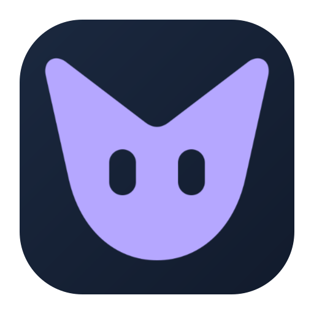
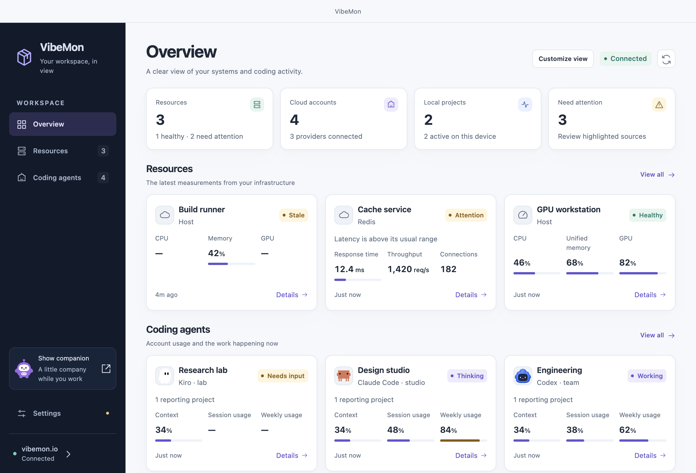
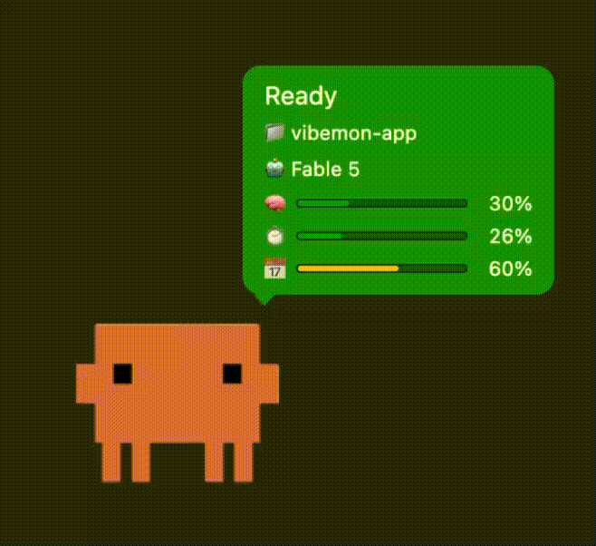

# VibeMon Desktop

[](https://github.com/opspresso/vibemon-app/releases/latest)
[](LICENSE)

Monitor selected resources and coding accounts from your desktop. VibeMon combines cloud summaries with local coding-agent activity, a floating character, and a speech bubble.

- Monitor custom resources, servers, DGX Spark hosts, and Kubernetes clusters.
- Automatically distinguish supported coding logins and monitor several profiles on one machine. [Setup and limits](https://vibemon.io/docs/coding-agents#keep-several-accounts-apart).
- Choose visible metrics and view recent-hour trends. Web edits to resource labels, ranges, and order appear on the next poll.
- Receive local tool events without a cloud connection. Hooks support Claude Code, Codex, Kiro, OpenClaw, and OpenCode.
- Add macOS widgets: each one shows the state and metrics of one resource or one coding agent.



## Install and start

On macOS:

```sh
brew install opspresso/tap/vibemon
```

For Windows or a direct macOS installer, download the matching package from [Releases](https://github.com/opspresso/vibemon-app/releases/latest). npm distribution is discontinued; existing npm packages do not receive updates.

Windows packages use the OpsPresso self-signed certificate. Windows may show an unknown-publisher warning, and automatic updates require a trusted publisher.

Open the installed VibeMon application. It starts in the system tray and listens locally on `http://127.0.0.1:19280`.

## Connect cloud sources

1. Click the menu-bar or tray icon and select **Dashboard**.
2. Open **Settings → Connections** and select **Sign in with VibeMon**.
3. In the browser, sign in with Google, Apple, or an email account, then select **Allow**. The App receives its own read token.
4. In **Overview**, open **Customize view**, select resources, provider accounts, and metrics, then select **Save view**.

The same verified email shares one VibeMon account across Web, Desktop, iPhone, and Android, regardless of the sign-in method. Each device receives its own scoped token. Apple Hide My Email supplies a different address; link it from Web Account if you want it to open an existing account.

For email sign-in, create an account on Web and confirm your email address first.

A source appears after its collector or hook sends the first report. Follow [Get started](https://vibemon.io/docs) to connect a coding tool or server. Use the same verified email for the sending computer and Desktop. Compare one card and its report time with the [Web dashboard](https://vibemon.io/dashboard); Desktop refreshes every 30 seconds. Provider credentials remain on the source machine.

If you already have a read token from [Account](https://vibemon.io/account), open **Use a read token instead**, enter the VibeMon address and token, then select **Save and connect**. The App keeps it in OS secure storage. **Disconnect this device** clears the local connection and attempts to delete that token from VibeMon. If VibeMon is unreachable, delete it on Web Account. Other clients using that token also lose access. See [the desktop workspace guide](docs/monitoring.md) for selection, missing data, sources on standby, and troubleshooting.

## Connect local coding tools

Open **Settings → Integrations → Install integration** for the tool you use, then restart that tool. Local character updates do not require a VibeMon sign-in. To send the same activity to VibeMon, select **Sign in to send activity** in **Send activity to VibeMon** and approve it in the browser. To use an existing write token, open **Use a write token instead** and select **Save and verify**. The App's read token is never reused for hooks.

Start a coding task. Check its activity under **On this device** in the App to confirm local hook delivery, then check the project's report time on the Web dashboard to confirm VibeMon delivery. A character can also follow a selected cloud project, so its movement alone does not identify the delivery path. The App does not install coding tools themselves or start collection on remote servers.

Tool detection honors `CLAUDE_CONFIG_DIR`, `CODEX_HOME`, `KIRO_HOME`, and `OPENCODE_CONFIG_DIR`. These variables must reach both the tool and App processes. OpenClaw installation is supported on macOS/Linux. See [Monitor coding agents](https://vibemon.io/docs/coding-agents) for terminal and Windows setup, and the [hook reference](docs/hooks.md) for event mappings.

## macOS widgets

On macOS 14 or later, select **Edit Widgets** on the desktop and search for **VibeMon Mac**. Add a **Resource · Mac** or **Coding Agent · Mac** widget for each item you want to watch, then edit the widget to choose the item. See [macOS widgets](docs/widgets.md).

## Character display

One character window follows the active local or selected cloud project. Drag the character or bubble to move them together; use **Settings → Companion → Character** to choose a fixed character. See [desktop features](docs/features.md) for states, characters, settings, and interaction details.



## Develop

Use Node.js 26.11.1 (`nvm use`) and the pnpm version pinned in `package.json`:

```sh
pnpm install --frozen-lockfile
pnpm start
```

Web development normally runs on `http://localhost:3030`; the unpackaged App accepts that loopback origin. Packaged apps require HTTPS. Build and validation commands are in [build and packaging](docs/build.md).

## Documentation and related projects

- [Documentation index](docs/README.md) — Desktop user and developer guides.
- [Local HTTP API](docs/api.md) — Loopback status, window, and health endpoints.
- [Send your own data](https://vibemon.io/docs/api) — Web API to send and read summaries with a token.
- [VibeMon service](https://vibemon.io) — Login, source configuration, and browser dashboard.
- [Hooks and collector source](docs/distribution.md) — Public installers, collector, shared schema, registries, and rendering assets live in this repository.
- [Web source](https://github.com/opspresso/vibemon-web) — Private service implementation; App installation, builds, and CI do not require access.
- [VibeMon Touch](https://github.com/opspresso/vibemon-esp32) — Four-inch ESP32-S3 display using the same HTTPS summaries, status rules, and palette. Legacy C6 devices use the previous firmware.

## License

MIT
