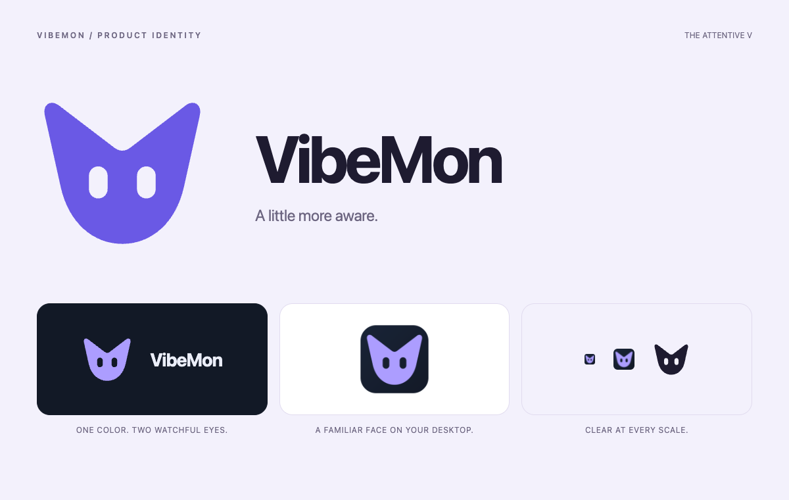
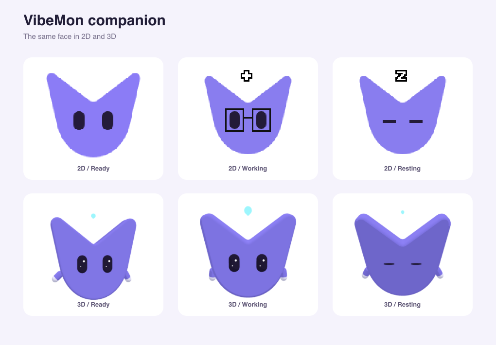

# Product design

VibeMon Web, Desktop, iOS, and Android share one visual language. Desktop adds local activity and companion settings. Web adds account, token, and collection management.

## Shared foundation

`src/shared/design/tokens.css` owns the product palette (including the fixed VibeMon Pro colors `--vm-pro-night`, `--vm-pro-violet`, `--vm-pro-blue`, `--vm-pro-glow`, and `--vm-pro-button-top`, which do not change with appearance), typography family, radii, control height, sidebar width, and motion duration. `src/engine/vibemon-companion.mjs` owns the V silhouette and eye bounds; `brand-mark.svg` is its generated product mark. `src/shared/data/monitoring.json` owns state labels, tones, attention priority and transition definitions, and the metric tone thresholds in `measurements.tones`: a metric whose key starts with `keyPrefix` is `warning` from `warningFrom` and `danger` from `dangerFrom` (both inclusive, in metric units); other metrics are `normal`. Timing values remain in `constants.json`. `src/shared/monitoring/state.cjs` applies those rules. `presentation.mjs` handles provider names, numeric precision and relative observation times.

After changing monitoring labels, run `node scripts/generate-monitoring.mjs --write`. It creates the local display module used by sandboxed renderers without network access. Distribution and design checks reject drift. Web imports a pinned public App snapshot; ESP32 compiles the same policy into a C++ state table. The behavioral cases in `src/shared/monitoring/cases.json` verify identical boundaries and account aggregation across runtimes.

Use violet for actions, blue for active work, teal for healthy states, amber for attention, and rose for errors. A measurement's magnitude does not imply failure: only plan limits have usage thresholds. Always pair color with a state label. Unavailable measurements are distinct from zero. Trend selectors show units once; axis labels use scientific notation for very large or tiny values, while readings and tooltips retain their precision. Sources on Standby keep their last observation and its age in the neutral color; Standby is never a warning.

Speech bubbles use opaque state colors and choose black or white text by relative luminance. The shared palette is checked against the [4.5:1 text contrast threshold](https://www.w3.org/WAI/WCAG22/Understanding/contrast-minimum.html). This check covers bubble colors; it does not establish full WCAG conformance.

The brand mark is an attentive companion shaped around the initial **V**. Two eyes are cut out of a single rounded silhouette, so the mark keeps its expression in one color and against either theme. The upward tips suggest awareness; the rounded base connects the technical workspace to its friendly desktop companion. Keep the square view box and transparent eye apertures. Do not add outlines, enclosing cubes, or state-dependent details to the mark.

App icons and Web favicons derive from the same geometry and fixed sidebar colors. On macOS, run `pnpm exec electron assets/generators/generate-icons.js` after changing those sources. Chromium's canvas renders the frames, so the generator needs no native image package. It writes the SVG mark, 128px VibeMon sprite, App PNG, Windows ICO, macOS ICNS, and Web favicon files together. Small frames enlarge the filled mark within the tile; they do not depend on fine strokes. Inspect the eye openings at 16px and 32px, then commit the generated assets and sync the public App revision into Web.

The default VibeMon companion shares the logo's silhouette in 2D and 3D. Its 128px sprite has 14×24px eyes starting at (39, 60) and (75, 60). These are top-left bounds, not eye centers. The generator verifies the registry against the shared geometry; blink, closed-eye, happy-eye, and glasses overlays use those bounds. The 3D rig maps the same anchors onto its beveled face. Other provider characters keep their existing artwork, eye coordinates, and 3D rig.

The new sprite is `vibemon-v2.png`. The public `characters/vibemon.png` URL retains the previous artwork for clients using older eye anchors. When changing artwork or anchors, use a new image filename and increase `characters.json.revision`. Desktop ignores cached revisions older than its bundle and never refreshes to an older revision, so an upgrade cannot combine old coordinates with new artwork.

## Workspace

Product cards use `--vm-radius-panel` (18 logical units) and `--vm-panel-padding` (16 logical units). Web and Desktop read the CSS tokens directly; the iOS and Android contract generators compile them into `ProductLayout`. State badges are soft capsules with a dot and a label, including neutral states. Active status is blue (`info`); violet (`accent`) identifies actions and resource icons. These meanings stay the same in light and dark appearance.

A resource card's icon comes from `resourceIcon()` in `presentation.mjs`. Each client draws the same role with its own icon set:

| Role | Source | Desktop | Web (Lucide) | iPhone and macOS widget (SF Symbols) | Android |
| --- | --- | --- | --- | --- | --- |
| `host` | Host collector | `resources` (server) | `Server` | `server.rack` | `ic_dns` |
| `unified` | Host with unified memory, such as DGX Spark | `chip` | `Cpu` | `cpu` | `ic_memory` |
| `cluster` | Kubernetes cluster | `layers` | `Layers` | `square.stack.3d.up` | `ic_layers` |
| `resource` | Custom resource | `gauge` | `Gauge` | `gauge.with.dots.needle.50percent` | `ic_speed` |

Keep each platform's system typography, accessible touch targets, navigation controls, and sheet behavior. The shared card geometry and information hierarchy do not require replacing native controls with browser controls.

Coding account cards use the project responsible for the displayed state as their title. Below the identity, `accountActivityLine()` shows that project's model and tool, such as `gpt-5 · Editing`. Without them it shows the number of reporting projects when there are two or more, and nothing otherwise. Accounts that only a connected service reads show no line. Older reporting input requests take priority over newer ordinary work; accounts on Standby keep their last project. Provider and account ID remain visible, and selection keys and latest account usage do not change. Desktop and Web share `agent-card.css`; iOS and Android render the same state effects with native drawing: working edges carry a moving light, thinking breathes, planning moves slowly, and compacting reverses a two-part trail. Input requests use a slow pulse; errors stay emphasized. Completed work settles into green, while idle and standby edges remain neutral. Hover and keyboard focus emphasize the edge without moving the card. The rounded track stays fixed; only its light angle and opacity animate. The `--vm-agent-*` durations in `tokens.css` also generate the native `AgentMotion` constants. Reduced-motion users receive a static edge. State-colored glow and a brighter moving light distinguish activity from the neutral canvas. Thinking uses violet, planning blends blue and teal, and compacting blends violet and rose. These edges are the `--vm-state-thinking`, `--vm-state-planning`, and `--vm-state-packing` tokens in `tokens.css`, as `light-dark()` hex pairs that clients can compile; the design test keeps them equal to their documented mixes of the base tokens. Other states use their tone color: active `--vm-info`, warning `--vm-warning`, danger `--vm-danger`, good `--vm-good`, and neutral `--vm-border`. Native effects do not intercept touches or add accessibility elements. Native frame updates stop when their card disappears or the app is inactive; completion settles once, and standby cards have no effect.

When an agent reports `usageWeekModel`, account details show it after weekly plan usage on every client, labeled `metric.weeklyModel` (for example **Weekly Opus**) or `metric.weeklyModelUnknown`, with its own reset countdown. Desktop and Web show it while weekly usage is a selected metric. Cards keep the three default agent metrics.

Keep primary navigation in this order: **Overview**, **Agents**, **Resources**. Put account or device settings below it. The page header names the current task and provides its primary action. **Customize view** controls source and metric selection without occupying the monitoring canvas.

Cards use the same hierarchy: identity, state, measurements, observation time, and **Details**. Keep each provider/account separate. A card's attention state includes all its fresh reporting projects; the account is on neutral **Standby** when none remain fresh. Details retain each project's individual status and recent history.

Use the system font, readable secondary text, consistent gaps, and a visible keyboard focus ring. At narrow sizes, reduce columns before shrinking labels. Dialogs must support Escape, contain keyboard focus, and return focus to their trigger. Input values must survive background refreshes.

The shared animation policy pauses character loops when their page is hidden or the OS requests reduced motion. Reduced motion uses a still pose that updates with the current status; it does not freeze status reporting. Speech-bubble loading dots and metric transitions also stop moving. Visibility and preference listeners are removed with the renderer.

### Platform presentation limits

These differences are intentional. Keep the meaning, values, and order the same everywhere, and change these only with evidence that the smaller form no longer fits.

| Where | Difference | Reason |
| --- | --- | --- |
| iPhone and Android Overview | The attention tile is titled **Attention** (`확인 필요`, `要確認`) with **All clear** or **Review below**; Desktop, Web, and Apple Watch use **Need attention**. | Three tiles share one phone row. **Need attention** truncates to "Need atte…" on an iPhone 17e. |
| iPhone, Android, and Touch metric rows | Plan usage uses the short labels `metric.short.usageSessionPercent` and `metric.short.usageWeekPercent` (**Session**, **Weekly**). | Value and reset countdown share one narrow row. |
| Touch | Values have no smaller, lighter fraction, and an account card has no connected-service link. | The LVGL 9.6 build has no label recolor or span widget, and the device has no **Connected services** screen to open. |

Reference captures: [Desktop light](images/workspace-shared-light.png) and [Desktop dark](images/workspace-shared-dark.png).

## Verification

Run `pnpm test:design` for shared presentation regressions. Compare all four clients with the same synthetic resources and accounts in light and dark themes. Check narrow screens, long names, unavailable values, standby data, loading, failures, empty workspaces, keyboard navigation, and reduced motion. Validate collection and editing separately from visual previews; previews must not use production credentials or publish synthetic observations.
