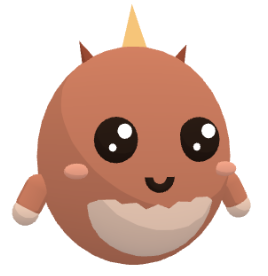
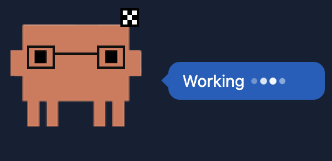
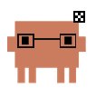
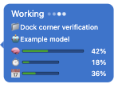
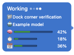
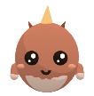

# Features

## Cloud resources and coding accounts

Select **Dashboard** from the tray menu to open the workspace and select custom resources, host/cluster presets, and multiple accounts per provider. The App polls summaries with an OS-encrypted read token. Web resource edits control labels, display ranges, and metric order; local hook activity still works independently. See [cloud monitoring](monitoring.md) for setup, selection, trends, and failure states.

The tray's orange-red dot shows that something needs you. The same dot marks where to resolve it:

| Issue | Tray menu item | Workspace mark |
|-------|----------------|----------------|
| A selected resource or coding account needs attention | **Dashboard** | **Resources** or **Coding agents** in the sidebar |
| The read connection failed | **Settings…** (opens Connections) | **Settings** and the **Connections** tab |
| An integration needs repair or an update, local delivery settings are invalid, or the cloud delivery check failed | **Integrations…** | **Settings** and the **Integrations** tab |
| An app update is available or ready to install | **About VibeMon** | **Settings** and the **About** tab |

A marked menu item shows the cause below its name, and the icon tooltip lists every cause. In the workspace, hover over a dot to read its cause; screen readers announce it. **Need attention** in Overview counts the affected resources and accounts. Inactive coding agents do not turn on a dot. `src/shared/attention.cjs` assigns each issue to its location for the tray and the workspace.

## Agent Support

VibeMon normalizes multiple agent ecosystems into one display model. The rendering layer is shared, but the integration path is not.

| Agent | Integration path | Best signal source | Observability quality | Important limitation |
|------|-------------------|--------------------|-----------------------|----------------------|
| Claude Code | Native hooks | Session, turn, and tool hooks | High | None significant for basic monitoring |
| Codex | Native hooks and non-interactive JSON output | Interactive lifecycle and local tool hooks, `codex exec --json` for automation | High | Hosted tools such as WebSearch do not pass through local tool hooks |
| Kiro | Native hooks | Prompt, tool, and stop hooks | Medium to high | Kiro documents no cancel event. A cancelled IDE turn can stay active until its next event or until Kiro exits |
| OpenClaw | Plugin bridge | Plugin SDK hooks | Medium to high | Internal hooks are not enough by themselves for full tool-loop visibility |
| OpenCode | Plugin + Python adapter | Session, chat, tool, permission, and compaction events | High | No context or plan-usage metrics; uses the default character until registered in this repository |

### Bridge Types

- **Native hook bridge**: Claude Code, Codex, and Kiro expose hook events that VibeMon can translate directly into `start`, `thinking`, `working`, `notification`, `packing`, and `done`.
- **Plugin bridge**: OpenClaw support is intentionally plugin-based. Its simpler internal hooks are session and message oriented, so VibeMon uses plugin SDK lifecycle hooks for better timing.
- **Plugin + adapter bridge**: OpenCode auto-loads `plugins/vibemon.js`, which passes events to `hooks/vibemon.py` and the shared `~/.vibemon/vibemon_core.py` transport. The Desktop App receives the same status payload as the other tools.

### Agent-Specific Notes

- **Claude Code**: Best overall source for real-time monitoring. It exposes a broad lifecycle including prompt, tool, permission, compact, and stop events.
- **Codex**: Strong interactive lifecycle and local tool coverage. VibeMon's `PreToolUse` and `PostToolUse` hooks observe shell commands, `apply_patch`, MCP tools, and other local function tools; `codex exec --json` remains useful for CI or batch jobs.
- **Kiro**: Strong tool-level support with explicit `PreToolUse` and `PostToolUse`, plus namespaced MCP tool names.
- **OpenClaw**: Strongest when treated as a plugin platform. The VibeMon bridge should continue to use plugin hooks instead of depending on the lighter internal hook system.
- **OpenCode** (1.18.29 or later): Session creation, prompts, tool execution, permission requests, compaction, and completion map to the existing states. Plan-agent activity uses `planning`; known child sessions are suppressed by the bridge. The adapter omits context and plan-usage fields when no measurement is available. See the [bridge event mappings](https://vibemon.io/docs/hooks#opencode) for details.

### OpenCode Setup

OpenCode 1.18.29 or later is required. One plugin file serves OpenCode 1.x and 2.x. In **Settings → Integrations**, click **Install integration** for OpenCode, then restart OpenCode. OpenCode discovers local plugins in `plugins/` at startup; no `opencode.jsonc` registration is required.

The installer places `plugins/vibemon.js` and `hooks/vibemon.py` under `OPENCODE_CONFIG_DIR`, or `$XDG_CONFIG_HOME/opencode` (default `~/.config/opencode`). Both files must be present for the app to report the integration as installed. Transmission settings come from the shared `~/.vibemon/config.json`.

On Windows, the installer pins the Python interpreter in the plugin; custom config directories also receive an absolute adapter path. The app normalizes these known path adaptations when checking the published plugin checksum, so updates remain detectable. A missing pinned interpreter or stale adapter reference is shown as **Needs repair**; use **Repair installation**, then restart OpenCode. Missing installation files restore the **Install integration** action.

## Characters

| Character | Color | Description | Auto-selected for |
|-----------|-------|-------------|-------------------|
| `vibemon` | Purple | Rounded V companion with two watchful eyes | Any bridge without its own character |
| `clawd` | Orange | Four-legged friend | Claude Code |
| `codex` | Navy | Cloud character with light eyes on a dark screen | Codex CLI |
| `kiro` | White | Ghost character | Kiro |
| `claw` | Red | Antenna character | OpenClaw |
| `daangni` | Peach/teal | Round face, fluffy top | Manual only (Character Lock) |

OpenCode reports `character: "opencode"`, which currently falls back to `vibemon` because the canonical registry does not contain that name. Its states, project, tool, and model remain visible. Add a dedicated character to this repository's registry and export map before it can be bundled or offered in Character Lock.

In **2D** (default) all characters use **image-based rendering** (128x128 PNG). Images bundled in `src/assets/characters/` load without network requests. Only new, versioned images from a refreshed registry are downloaded from `vibemon.io/static`; downloads are bounded to 64 KiB and must declare 128×128 PNG dimensions. Character is **auto-selected by bridge**, not by the core display runtime. You can also force one with [Character Lock](#character-lock).

Characters are defined in `src/shared/data/characters.json`: display name, accent color, PNG, eye/effect coordinates, and 3D theme. App owns these sources; Web serves the pinned public snapshot at `vibemon.io/static/data/characters.json`. Rendering, tray menus, and validation derive from the same registry. Add the image and registry entry here, update `web-distribution.json`, and run `pnpm check:registry` plus `pnpm check:distribution`.

### Render Mode

**Settings → Companion → Render style** switches the character window between the two engines; the choice persists and the open window reloads into it.

- `2d` (default): the pixel-art sprite described above
- `3d`: a procedurally rendered pet (three.js) — no images are used. VibeMon uses the rounded V silhouette and eye anchors shared with its logo and 2D sprite. Other characters retain the horned rig, tinted by their registry `theme` (`body`/`belly`/`accent`/`eye`/`blush`/`flame`). Character Lock and per-project switching work in both modes.

**Settings → Companion → Size** offers 100% through 30% in 10-point steps. The choice applies to both render modes and persists across restarts. The 3D canvas uses the largest uniform scale that fits each pose about the camera center, leaving a 2px margin. It recalculates before rendering each frame, including state transitions, and uses higher WebGL resolution for sharp enlargement. The 2D presentation is unchanged.

Both engines are maintained here (`src/engine/`); three.js ships locally in `src/vendor/` because the renderer CSP forbids runtime CDN imports.

Desktop 3D hit testing reads the preserved WebGL frame and reuses the alpha result for an unchanged pixel and frame. Pointer checks never render the scene, so they respect the animation frame limit and reduced-motion setting. Web rendering keeps the default unpreserved buffer. Run `pnpm test:hit-testing` to verify transparent pixels, transformed coordinates, and stopped frames in Electron.

### Character Lock

Forces the character window to always show one character, ignoring whatever character each project's status reports.

- `auto` (default): each project shows its own character
- Any character name: that character is always shown instead, applied immediately to the open window
- Choose **Settings → Companion → Character** or use `POST /character-lock`
- Switching back to `auto` immediately restores the focused project's latest reported character. Local activity keeps the original tool identity even while a fixed companion is selected.

## States

The state drives the character's eyes/effects on the sprite, the speech
bubble's background color, and the tray icon's background color. States
are defined in a single registry (`src/shared/data/states.json`): bubble
color/text, focus and loading behavior, and eye/effect type all live in
one entry per state.

| State | Color | Eyes + effect | Bubble text | Trigger |
|-------|-------|---------------|-------------|---------|
| `start` | Cyan | sprite eyes + sparkle | Hello! | Session begins |
| `idle` | Green | sprite eyes, periodic blink | Ready | `start` or `done` aged 1 minute |
| `thinking` | Purple | sprite eyes + thought bubble | Thinking | Prompt submitted, or a tool ended |
| `planning` | Teal | sprite eyes + thought bubble | Planning | `thinking` or `working` in plan mode |
| `working` | Blue | glasses + sparkle | (tool-based) | Tool running |
| `packing` | Gray | sprite eyes + thought bubble | Packing | Context compacting |
| `notification` | Yellow | sprite eyes + question mark | Input? | User answer or approval needed |
| `done` | Green | happy eyes | Done! | Turn ended (stop, interrupt, or session end) |
| `sleep` | Navy | closed eyes + Z | Zzz... | `idle` aged 5 minutes |
| `alert` | Red | sprite eyes + exclamation | Alert | Critical error or failure |

### Working State Text

The `working` state's speech bubble shows fixed text based on the active tool:

| Tool | Text |
|------|------|
| Bash | Running |
| Read | Reading |
| Edit | Editing |
| Write | Writing |
| Grep / WebSearch | Searching |
| Glob | Scanning |
| WebFetch | Fetching |
| Task | Tasking |
| Default | Working |

### State Timeout

| From State | Timeout | To State |
|------------|---------|----------|
| `start`, `done` | 1 minute | `idle` |
| `planning`, `thinking`, `working`, `packing`, `notification`, `alert` | 5 minutes | `idle` |
| `idle` | 5 minutes | `sleep` |

The timeout counts from the last report. While an agent turn runs, hooks repeat its state every 60 seconds (see [turn lifecycle](hooks.md#turn-lifecycle)), so a long tool call or response stays active until the turn ends. An active state reaches `idle` only when its reports stop, for example when the hooks cannot identify the agent process.

After 10 minutes in sleep state, the window automatically closes. It reappears on the next status update — or on demand via the tray menu's **Show companion** action, which reopens the character (and its speech bubble) immediately.

## Animations

- **Floating**: Gentle motion (±3px horizontal, ±5px vertical, ~3.2s cycle)
- **Glasses**: Working state character wears frame-only glasses (lenses stay clear, eyes remain visible)
- **Sparkle**: Session start and working states show rotating sparkle effect
- **Thought bubble**: Thinking, planning, and packing states show animated thought bubble
- **Zzz**: Sleep state shows blinking Z animation
- **Loading dots** (speech bubble): Thinking/planning/packing/working states show animated progress dots — thinking-style states run 3x slower than working
- **Metric bars** (speech bubble): Gradient colors based on usage thresholds:
  - 0-50%: Green
  - 51-70%: Yellow
  - 71-90%: Orange (warning)
  - 91-100%: Red (critical)

## Character Window

The app shows exactly one character window plus its following speech bubble:

- Follows whichever project is currently "focused": the focused project holds the window while it is busy — in an active state (thinking, planning, working, packing, notification, alert) or within 4 seconds of its last active update — so the brief done/idle moments between tools don't bounce the window between concurrent sessions. `alert`/`notification` from another project switch immediately; once the focused project settles, the most recently updated project takes over.
- Status updates for unfocused projects are still recorded in the background (up to 50 projects) and become visible the moment that project gains focus.
- Can be dragged past the screen edge while the drag is in progress; once you let go, it's clamped back fully on-screen.
- Reappears at the same spot you last left it, across restarts.
- The speech bubble follows the character everywhere:
  - A pure rectangle calculation chooses a full-size position before considering a smaller fit; ordinary placement prefers above the character. No physics simulation runs during movement.
  - If the character is pinned to the top or bottom edge, the bubble moves beside it; a shorter bubble shares the character's vertical center, including at Dock corners
  - If the character is pinned to the left or right edge, the bubble moves above or below it

  Short bubble at a bottom corner, composed from native window captures at their measured positions:

  

- Shows just the character sprite on a transparent background — status text and metrics live in the speech bubble.

## Desktop App Features

- **Single instance**: Only one app instance can run at a time
- **Frameless window**: Clean floating design
- **Always on Top**: Stays visible above other windows (configurable modes)
- **System Tray**: Quick access from menubar/taskbar
- **Draggable**: Move the character anywhere on screen
- **Snap to corner**: Can be dragged past the screen edge mid-drag; once you let go, it's clamped back on-screen, snapping flush to a corner within a 30px threshold
- **macOS Dock corners**: Dropping the character at a bottom corner uses the free space beside a bottom Dock, or below a side Dock, while respecting Edge Margin. **Settings → Companion → Dock corner size** chooses the behavior and saves it across restarts. **Keep current size** is the default: both overlays retain their sizes and sit beside or above each other in the available space. If neither arrangement fits, normal work-area placement preserves their sizes. **Auto shrink** scales both overlays, including the bubble's tail, to fit the Dock's narrow strip; dragging away restores Character Size and the bubble's natural size. Changing the setting immediately updates a parked character. Dock geometry is refreshed while a character rests in a bottom corner; unavailable or hidden Dock geometry uses normal work-area placement.

  Dock geometry uses the read-only, undocumented macOS `CoreDockGetRect` function, with a public `CGWindowListCopyWindowInfo` fallback. Neither Accessibility nor Screen Recording permission is requested. A future macOS release may remove or change the private function; unusable geometry preserves normal work-area snapping. `pnpm test:overlays --require-dock` requires detection of a real visible Dock in addition to the deterministic fixture checks.

  Native window captures with **Auto shrink** enabled and an 801 × 56-point Dock (Retina 2×):

  | Bottom-left (2D) | Bottom-right (3D) |
  | --- | --- |
  |   |   |

- **Position survives lock/sleep**: When macOS moves the window itself — screen lock, system sleep, or a display detaching — that move is not saved, and the window returns to its remembered position once its display is back
- **Remembered position**: The window spawns at the position it was last dragged to
- **Click to focus terminal**: Click the character to switch to iTerm2/Ghostty tab (macOS only)

### Always on Top Modes

| Mode | Description |
|------|-------------|
| `all` | The window stays on top regardless of state - **Default** |
| `active-only` | Only active states (thinking, planning, working, packing, notification, alert) stay on top |
| `disabled` | The window never stays on top |

When `active-only` is selected:
- Active states (thinking, planning, working, packing, notification, alert) immediately enable always on top
- Inactive states (start, idle, done, sleep) immediately disable always on top (prevents focus stealing)

Choose **Settings → Companion → Stay on top**.

### Click to Focus Terminal (macOS)

When running Claude Code in multiple terminal tabs, clicking the character window automatically switches to the corresponding terminal tab.

**Supported Terminals:**
- iTerm2 (full tab switching support)
- Ghostty (application activation)

**Requirements:**
- macOS only (uses AppleScript)
- iTerm2 or Ghostty terminal

### Speech Bubble

A small, transparent window with input only on its visible body and tail that displays selected info fields (status, project name, model, memory, 5h usage, weekly usage, model-scoped weekly usage — e.g. "Fable 12% · 4d11h") next to the character. Each plan-usage row shows its own reset countdown when available. Positioned automatically so it never overlaps the character window and stays on-screen, with an animated slide when it needs to move.

- Select fields under **Settings → Companion → Speech bubble**: Activity, Project name, Model, Context usage, Session usage, Weekly usage, and Model usage.
- The status field shows state-based text (e.g. "Ready", "Thinking") and tool-based text while working (e.g. "Reading"), with animated loading dots during thinking/planning/working/packing — slower for thinking-style states

### Workspace and settings

The tray icon opens a menu. Select **Dashboard** to open the workspace with Overview, Resources, Coding agents, and Settings. Connections, Companion, Integrations, and About share its navigation and connection state. Preference changes apply immediately; connection and display-selection forms require Save. Search fields and unsaved choices survive automatic polling.

The tray menu provides Dashboard, Settings, Show companion, Integrations, About VibeMon, and Quit VibeMon. Usage and preference controls live in the workspace instead of submenus. **Show companion** restores the last shown character and speech bubble after they close, without waiting for another status event.

See [the desktop workspace guide](monitoring.md) for navigation, connection, settings, and recovery.

## Rendering Engine

The character is rendered by a bundled engine (`src/engine/vibemon-engine.js`): a 128x128 canvas drawing the character PNG, state-driven pixel-art eyes/effects, and the floating animation, over a fully transparent background. Bundled character images load locally, so starting or reopening the companion does not wait for the CDN. New registry artwork uses bounded downloads; keep versioned filenames when changing artwork.

## Hook installation and updates

Hook installation verifies the downloaded installer against the `installer` SHA-256 published in the same origin's `manifest.json` (fetched fresh at install time), so install.py updates ship with a Web deployment alone — no app release needed. install.py then re-checks every file it downloads against that same manifest before writing it, so install.py and manifest.json have to go out in the same deploy. Custom installer deployments can pin a specific hash via `VIBEMON_INSTALLER_SHA256` together with `VIBEMON_DOCS_URL`; the pin takes precedence over the manifest. `VIBEMON_DOCS_URL` selects the source for the installer, manifest, and all installed files. The App passes the same source to the Python child. Use `VIBEMON_URL` separately for the API origin; see [self-hosted installation](../public/install/setup.md#self-hosted-installation).

Installs run unattended but not force-approved: the app passes a platform flag and never `--yes`. VibeMon's own hook scripts are upgraded in place, while settings you own — most visibly an existing Claude Code `statusLine` — are left as they are. Run install.py yourself with `--yes` to have those replaced too. The periodic hook check (shortly after launch, then every 30 minutes) compares installed integrations with the manifest and runs this installer for every one that drifted, so a Web deployment of hook or shared-script fixes reaches each running App without a manual Reinstall. Broken registrations are only reported; fix them from Settings → Integrations. When a run fails, the installer's own reason (a failed integrity check, a file it couldn't write) is shown with the exit code instead of the bare code.

Detection and hook paths honor `CLAUDE_CONFIG_DIR`, `CODEX_HOME`, `KIRO_HOME`, and `OPENCODE_CONFIG_DIR` (with the OpenCode XDG fallback described above). These variables must reach the Desktop App process. Kiro is detected through either `kiro` or `kiro-cli`.

Registration checks inspect the command used on the current OS, including Codex's Windows override and the installer's quoted POSIX paths. OpenClaw requires its script, manifest, and enabled `vibemon-bridge` entry. The installer records `plugins.load.paths`, and existing installations in the global extensions directory are also recognized without that entry. Global disable, deny entries, and a non-empty allowlist that excludes VibeMon prevent an installed status, matching [OpenClaw's plugin policy](https://docs.openclaw.ai/tools/plugin#configure-plugin-policy). After an OpenClaw update, refresh its persisted plugin registry and restart the gateway as described in the [setup guide](https://vibemon.io/docs/hooks#openclaw-configuration). The docs installer currently skips OpenClaw on Windows.

See [build and release](build.md) for packaging commands.
