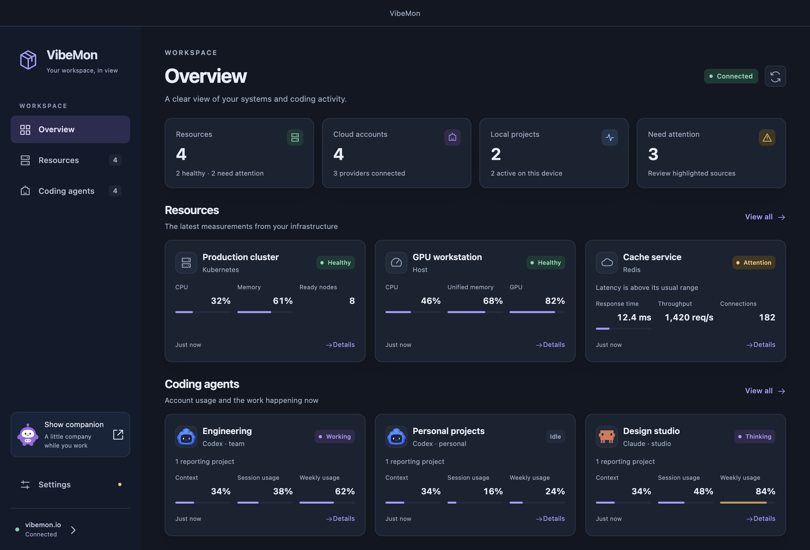
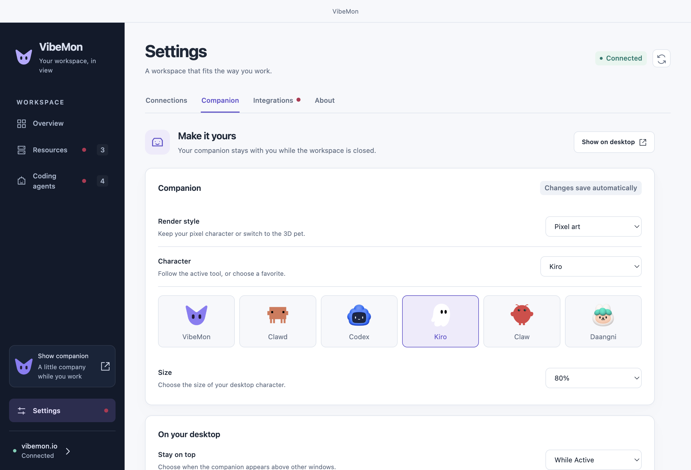

# Desktop workspace

Click the VibeMon menu-bar or tray icon to open **Overview**. Resources and coding accounts appear together; local projects and available plan usage appear below them. Use the sidebar for **Resources**, **Coding agents**, or **Settings**. Closing the workspace keeps the companion and local hooks running. **Show companion** restores the character to the desktop.

The secondary tray menu provides Dashboard, Settings, Show companion, Integrations, About, and Quit. Preferences live in the workspace. Keyboard shortcuts are `Cmd/Ctrl+1` for Overview, `Cmd/Ctrl+2` for Resources, `Cmd/Ctrl+3` for Coding agents, and `Cmd/Ctrl+,` for Companion settings.

## Connect your cloud workspace

1. Sign in to [Web Account](https://vibemon.io/account) with Google. Create a token with read permission. **Show token** retrieves an existing token.
2. Open **Settings → Connections** in Desktop. Enter the Web address and read token, then select **Save and connect**.
3. Open **Customize view**. Select resources, provider accounts, and visible metrics, then select **Save view**. **Discover sources** refreshes the available list without discarding unsaved choices.

The read token is encrypted with Electron `safeStorage`, backed by the operating system keychain or secret service. The saved value never returns to the renderer. Linux `basic_text` storage is rejected. Unlock or configure secure storage if the App cannot save a token. **Disconnect this device** removes the local credential and displayed cloud data. Delete the token in Web Account to revoke it for every client. Dashboard read tokens are never copied to hook configuration.

Latest state is polled every 30 seconds, restricted to the saved selection. Selecting no sources pauses data requests and preserves the connection result. The local project and usage panels work without a cloud connection. HTTPS is required; an unpackaged development App also accepts loopback HTTP for isolated tests.

## Resources and history

Resource cards support arbitrary types, metric labels, units, order, and display ranges. Host cards support CPU, memory, GPU, and temperature. Spark reports **Unified memory**. Kubernetes cards support CPU, memory, ready/total nodes, and unhealthy pods.

Use **Add resource** to define a database, queue, sensor, or another resource on Web. Send observations using its generated contract, then discover it in Desktop. **Details → Edit resource on Web** edits an existing resource, including Spark and Kubernetes presets. Saved labels, ranges, and metric order apply on the next poll. Custom metric choices are scoped to a resource, so equal keys on different resources stay independent.

**Details** shows current readings, collection status, and the recent hour. History loads on demand and refreshes every minute while visible. Closing the detail dialog or hiding the workspace stops its refresh timer. Signed values and measurements outside a display range remain visible in the chart. Historical values use the definitions returned with their history response.

Chart gaps mean no recorded measurement. Resource heartbeats include fresh measurements and add minute samples. Agent heartbeats refresh status without adding activity samples. A single observed minute appears as a point. Web retains visible trends for 24 hours; Desktop requests the recent hour. A status-only resource has no numeric history.

## Coding accounts and local activity

Each provider/account ID has its own card and selection. Codex, Claude, Kiro, and other providers can each have several accounts. Cards show the account ID, latest observation's usage, and reporting projects. Search by account or project, or filter by provider. The account history averages its summaries; percentages are not summed.

Equal project names across accounts remain separate. Identity metadata does not switch tool logins: use each tool's matching signed-in environment. **Connect account** opens Web's account setup, including Kiro account overrides. See the [provider/account contract](https://vibemon.io/docs/api/monitoring#multiple-provider-accounts).

**On this device** lists local hook activity independently of cloud accounts. Fresh selected cloud observations also enter the existing companion routing path under cloud-specific IDs. Local and cloud projects cannot overwrite each other by sharing a name.

## Settings

- **Connections**: Web origin, read token, connection recovery, and dashboard selection.
- **Companion**: 3D or pixel art, character, size, always-on-top behavior, edge distance, macOS Dock scaling, speech-bubble fields, workspace appearance, and login preference.
- **Integrations**: hook installation and repair, installation prompts, and advanced HTTP/serial delivery settings.
- **About**: App version, update actions, documentation, and release notes.

**About → Download update** downloads and verifies the package without closing the App. Select **Restart and install** when ready. Ordinary App exit does not install a pending update.

Preference changes save automatically. Connection and selection forms save only when submitted. Automatic polling keeps typed values and unsaved selections intact.

## Recovery

| Display | Meaning and action |
| --- | --- |
| `—` | No supported measurement was reported. This is not zero. |
| **Stale** | No accepted receipt for 120 seconds. Check the collector; displayed values are the last known observation. |
| **Token not accepted** | Retrieve an active read token from Web Account. |
| **Read access required** | Replace the token with one that has read permission. |
| **Replace saved token** | The local credential cannot be decrypted. Enter it again from Web Account. |
| **Connection interrupted** | Check the Web address and connectivity. Retained readings remain visible and become stale. |
| No selected resources or accounts | Use **Customize view**, or start collection in the same Web account. |

## Verify changes

Run `pnpm test:workspace` for the isolated Electron UI test. It uses a loopback API, synthetic resources/accounts, and fake integration/credential ports. It does not access your provider credentials, keychain, login items, or hook configuration. Screenshots are written to `out/workspace-tests/`. For an interactive preview, run `pnpm preview:workspace`.

`pnpm exec jest tests/monitoring.test.js tests/workspace-window.test.js tests/workspace-settings.test.js --runInBand` checks polling, selection, credential boundaries, trusted IPC, and settings operations. `pnpm test:overlays` checks the existing 3D/2D character and speech-bubble behavior, including changes made from the new settings screen.

The optional `tests/native/monitoring-smoke.cjs` tests a separate Web fixture with real OS encryption. Set `VIBEMON_TEST_FIXTURE` to the private JSON emitted by Web's `scripts/local-monitoring-fixture.ts` and `VIBEMON_TEST_ORIGIN` to its loopback URL. It can require OS keychain authorization. Keep its screenshots in `out/monitoring-tests/`; they can contain fixture account data and are not publication assets.
