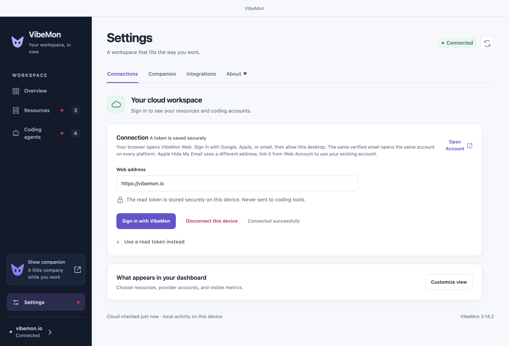

# Desktop workspace

Click the VibeMon menu-bar or tray icon to open its menu, then select **Dashboard** to open **Overview**. Resources and coding accounts appear together; local projects and available plan usage appear below them. Use the sidebar for **Resources**, **Coding agents**, or **Settings**. Select **Need attention** in Overview to show selected cloud sources with warnings, errors, stale resource data, or active projects waiting for input. Inactive coding projects do not need attention. Select it again to restore the overview. Closing the workspace keeps the companion and local hooks running. **Show companion** restores the character to the desktop.

The tray menu provides Dashboard, Settings, Show companion or Hide companion, Integrations, About, and Quit. The application menu uses the same workspace pages. On Windows, press `Alt` to reveal the menu bar. Preferences live in the workspace. Keyboard shortcuts are `Cmd/Ctrl+1` for Overview, `Cmd/Ctrl+2` for Resources, `Cmd/Ctrl+3` for Coding agents, and `Cmd/Ctrl+,` for Companion settings. `Cmd/Ctrl+W` closes the workspace window without quitting the App.

## Connect your cloud workspace

1. Open **Settings → Connections** in Desktop and select **Sign in with VibeMon**. Your browser opens the Web address.
2. Sign in with Google, Apple, or an email account and select **Allow**. For email sign-in, create an account on Web and confirm the address first. The browser returns to the App on `http://127.0.0.1:19280/auth/callback`, and the App receives a read token named **VibeMon Desktop (host name) · read**.
3. Open **Customize view**. Select resources, provider accounts, and visible metrics, then select **Save view**. **Discover sources** refreshes the available list without discarding unsaved choices. When every listed item in a group is selected, the view follows that whole group, including accounts, resources, and metrics that appear later. A partial selection shows only the chosen items; open **Customize view** to add new ones. Selections saved by Desktop 3.7.2 or earlier reset to all accounts, resources, and metrics once, because those versions saved a full selection as a fixed list.

Web resolves Google, Apple, and email sign-ins with the same verified email to one account. Desktop uses the owner returned by Web; it never derives an owner from a provider name or email. Its read token and the hooks' write tokens remain separate credentials for that same account. Different addresses, including Apple private relay addresses, need explicit linking from Web Account. See [one account on every platform](https://vibemon.io/docs#one-account-on-every-platform). A Google or Apple login does not set an email password; adding password sign-in requires email account creation and confirmation. The available methods are managed on Web Account.

Sign-in uses OAuth authorization code with PKCE and a loopback redirect: the code works once, and only this App holds the verifier that exchanges it. To use a token that you created on Web Account instead, open **Use a read token instead**, paste it, and select **Save and connect**. Sign-in needs the local HTTP server. If another program uses port 19280, sign-in stops at once with an explanation; use a token instead.

**Cancel**, a new sign-in, a manual connection change, or disconnect prevents an unfinished sign-in from saving its connection. This includes token exchange and the access check after it. An exchange already in progress finishes within its request timeout so the App can delete any token it received; it never adopts that token after cancellation. Read access and cloud delivery use the same cancellation rule.

A replacement read token is verified before it replaces the saved connection. Failed checks preserve the current workspace and credential. After a replacement, the App deletes the replaced token on Web (`DELETE /api/v1/connection`) because no other part of this device uses it. When a sign-in gets a token but the App cannot save it, the App deletes that new token on Web before it shows the error. These deletions are best effort: a token that Web cannot delete stays in Web Account. The read token is encrypted with Electron `safeStorage`, backed by the operating system keychain or secret service. The saved value never returns to the renderer. Linux `basic_text` storage is rejected. Unlock or configure secure storage if the App cannot save a token. **Disconnect this device** removes the local credential and displayed cloud data, then deletes that token on Web (`DELETE /api/v1/connection`). When Web cannot be reached, the App says so; delete the token in Web Account. Dashboard read tokens are never copied to hook configuration.

Latest state is polled every 30 seconds, restricted to the saved selection. When Web rejects the token (HTTP 401 or 403), scheduled polls stop until you sign in, save a token, change the view, or select refresh. Selecting no sources pauses data requests and preserves the connection result. The local project and usage panels work without a cloud connection. HTTPS is required; an unpackaged development App also accepts loopback HTTP for isolated tests.

Scheduled and manual polls of `GET /api/v1/sources` are conditional. The App sends `If-None-Match` with the `ETag` of the last 200 response for the same Web origin, token, and query (`ids` and `accounts`). On 304 Not Modified, the App keeps those sources and takes the server time from the `X-Server-Time` header. A 304 without a valid `X-Server-Time`, or without a cached 200 response, is an invalid response and the poll fails. The App forgets the cached response when the origin, token, or query changes, when you disconnect or polling stops, and after any failed poll; the next request is then unconditional. Each completed poll still sends one update to the dashboard, as before.

Cloud report age is anchored to the response's `serverTime` (or `X-Server-Time` on 304) and advances with a monotonic elapsed clock. The computer's date or time-zone settings do not change freshness, attention, or the recent-hour window. Failed requests keep aging the last accepted snapshot; they do not reset its age.

Session and weekly usage show the time until that plan limit resets, for example `Resets in 2h5m`, in the companion bubble, the account cards on **Coding agents**, account details, the usage panel, and the macOS widgets. The smaller Overview cards show it when you point to a usage metric. The format is `now`, `42m`, `2h5m`, or `3d1h`. Nothing is shown when the hook reports no reset time.

Cloud reset countdowns use the observation timestamp and the same cloud clock. Local hook countdowns use their local observation time. Each monitoring poll refreshes a visible bubble only when its displayed values change; this does not refresh agent activity, extend sleep timers, or reopen a closed companion. A legacy report without an observation timestamp keeps its supplied duration.

## Resources and history

Resource cards support arbitrary types, metric labels, units, order, and display ranges. Host cards support CPU, memory, GPU, and temperature. Spark reports **Unified memory**. Kubernetes cards support CPU, memory, ready/total nodes, and unhealthy pods.

Overview uses compact readings. Full custom-resource cards and details retain up to six significant digits.

Use **Add resource** to define a database, queue, sensor, or another resource on Web. Send observations using its generated contract, then discover it in Desktop. **Details → Edit resource on Web** edits an existing resource, including Spark and Kubernetes presets. Saved labels, ranges, and metric order apply on the next poll. Custom metric choices are scoped to a resource, so equal keys on different resources stay independent.

**Details** shows current readings, collection status, and the recent hour. History loads on demand and refreshes every minute while visible. Closing the detail dialog or hiding the workspace stops its refresh timer. Signed values and measurements outside a display range remain visible in the chart. Historical values use the definitions returned with their history response.

Chart gaps mean no recorded measurement. Resource heartbeats include fresh measurements and add minute samples. Agent heartbeats refresh status without adding activity samples. A single observed minute appears as a point. Web serves minute history for 24 hours and, with Pro, hour history for 7 or 30 days. Desktop requests only the recent hour, even when the shared account has Pro. A status-only resource has no numeric history.

History details show minute averages and maxima with gaps for unavailable observations. A failed history request keeps its error visible until a successful retry. Hidden metrics do not trigger history requests.

## Send local activity to Web

Open **Settings → Integrations → Send activity to Web** and select **Sign in to send activity**. After you allow it on Web, the App saves a write token named **VibeMon Desktop (host name) · write** for the local hooks. To paste a write token instead, open **Use a write token instead** and select **Save and verify**. Verification checks permissions without creating a source or test observation. Only a successful check replaces the saved connection; the next real hook event sends data.

**Check saved connection** checks the current token again. Rejected, read-only, unreachable, and unsupported servers have separate messages. The displayed check time is explicit; it is not a continuous delivery guarantee. A different Web origin requires a new write token. A successful replacement deletes the replaced write token on Web. **Remove saved write token** removes the shared hook credential, then deletes it on Web, while preserving local delivery and the independent read connection. When Web cannot be reached, the App says so; delete the token in Web Account. Replacing or removing the shared write token stops every client that uses the same token value, including hooks or collectors where you pasted it by hand. Agent environment variables and OpenClaw plugin settings can override these shared defaults. Stored write tokens never return to the settings renderer.

## Coding accounts and local activity

Each provider/account ID has its own card and selection. Generated IDs use eight-character labels, such as `Codex · 27e702a8`; selection and API requests keep the full ID. Codex, Claude, Kiro, and other providers can each have several accounts. Cards show the account label, latest observation's usage, and reporting projects. The status badge surfaces errors, input requests, and warnings from projects still reporting. Coding hooks report events, and they repeat a running turn's state every 60 seconds as a heartbeat, so a long tool call or response stays active. Each project's state follows its last report through the [state timeouts](features.md#state-timeout); a project is **Inactive** once that clock reaches `sleep`, and an account is **Inactive** when all its projects are. An event's health ages with its state. Inactive projects do not affect attention counts or the tray badge. Cards that need attention come first, then the others by project; inactive accounts come last, the most recently active first. App and Web share the same state and account rules. **Details** preserves each project's status, including stopped projects. Search by account or project, or filter by provider. The account history averages its summaries; percentages are not summed.

Equal project names across accounts remain separate. Use separate signed-in tool profiles for simultaneous accounts. **Settings → Integrations → Accounts on this machine** lists observed profiles and distinguishes verified accounts, credentials, unidentified profiles, and manual labels. **Connect account** opens Web's automatic setup guide and optional manual overrides. Identity metadata does not switch provider logins. See the [provider/account contract](https://vibemon.io/docs/api#send-coding-agent-activity).

**Details → Remove on Web** opens a removal confirmation in your browser. Sign in with the same VibeMon account as Desktop. The App checks which workspace its read token belongs to before opening the link. Removing an account removes its registered projects; an active hook or collector can register them again.

**On this device** lists local hook activity independently of cloud accounts. Fresh selected cloud observations also enter the existing companion routing path under cloud-specific IDs, and a new cloud event competes for the companion like a local one. A source that this device's hooks deliver locally is shown only through local delivery, which is immediate and supports terminal focus; it replaces an earlier cloud copy. Local and cloud projects cannot overwrite each other by sharing a name.

## Settings

- **Connections**: Web origin, read token, connection recovery, and dashboard selection.
- **Companion**: 3D or pixel art, character, size, always-on-top behavior, edge distance, macOS Dock scaling, speech-bubble fields, workspace appearance, and login preference.
- **Integrations**: hook installation and repair, installation prompts, and advanced HTTP/serial delivery settings.
- **About**: App version, update actions, documentation, and release notes.

**About → Download update** downloads and verifies the package without closing the App. Select **Restart and install** when ready. Ordinary App exit does not install a pending update.

Preference changes save automatically. Connection and selection forms save only when submitted. Automatic polling keeps typed values and unsaved selections intact.

## Recovery

| Display | Meaning and action |
| --- | --- |
| `—` | No supported measurement was reported. This is not zero. |
| **Stale** | A resource has no accepted receipt for 120 seconds. Check the collector; displayed values are the last known observation. |
| **Inactive** | A coding project's last report has aged to `sleep`: its turn ended or its hooks stopped reporting. No action is required. |
| **Token not accepted** | Select **Sign in with VibeMon** again, or paste an active read token from Web Account. |
| **Read access required** | Replace the token with one that has read permission. |
| **Replace saved token** | The local credential cannot be decrypted. Enter it again from Web Account. |
| **Connection interrupted** | Check the Web address and connectivity. Retained readings remain visible and become stale. |
| No selected resources or accounts | Use **Customize view**, or start collection in the same Web account. |

## Verify changes

Run `pnpm test:workspace` for the isolated Electron UI test. It uses a loopback API, synthetic resources/accounts, and fake integration/credential ports. It does not access your provider credentials, keychain, login items, or hook configuration. Screenshots are written to `out/workspace-tests/`. For an interactive preview, run `pnpm preview:workspace`.

`pnpm exec jest tests/monitoring.test.js tests/workspace-window.test.js tests/workspace-settings.test.js --runInBand` checks polling, selection, credential boundaries, trusted IPC, and settings operations. `pnpm test:overlays` checks the existing 3D/2D character and speech-bubble behavior, including changes made from the new settings screen.

The optional `tests/native/monitoring-smoke.cjs` tests a separate Web fixture with real OS encryption. Set `VIBEMON_TEST_FIXTURE` to the private JSON emitted by Web's `scripts/local-monitoring-fixture.ts` and `VIBEMON_TEST_ORIGIN` to its loopback URL. It can require OS keychain authorization. Keep its screenshots in `out/monitoring-tests/`; they can contain fixture account data and are not publication assets.
