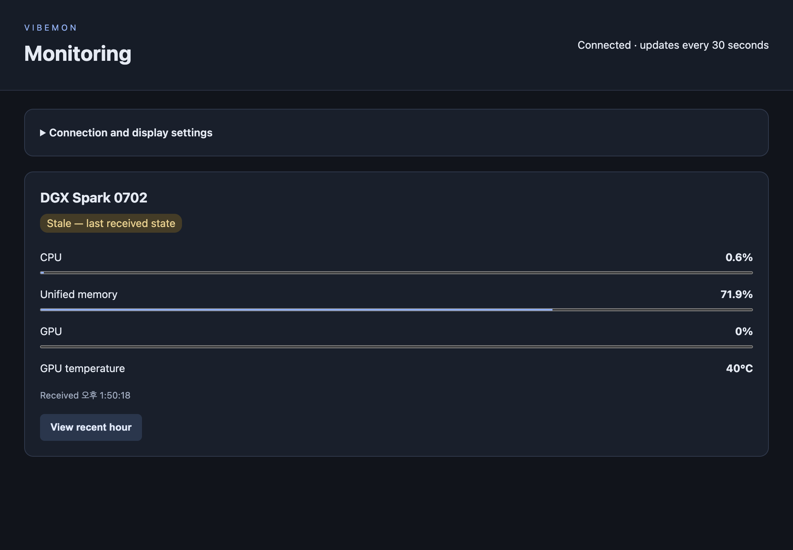
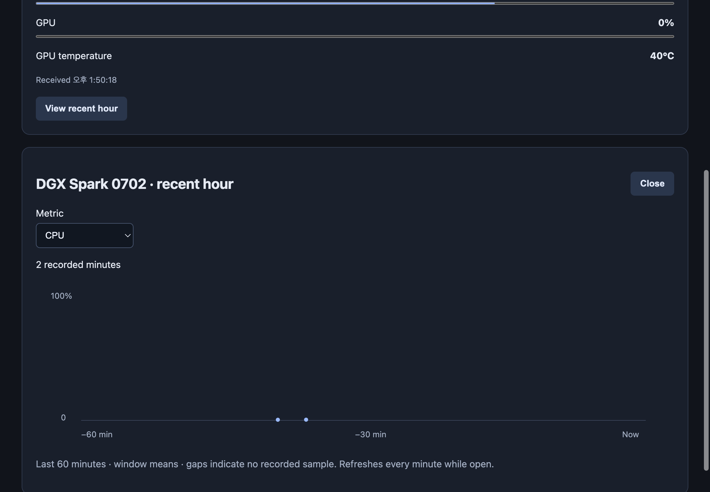
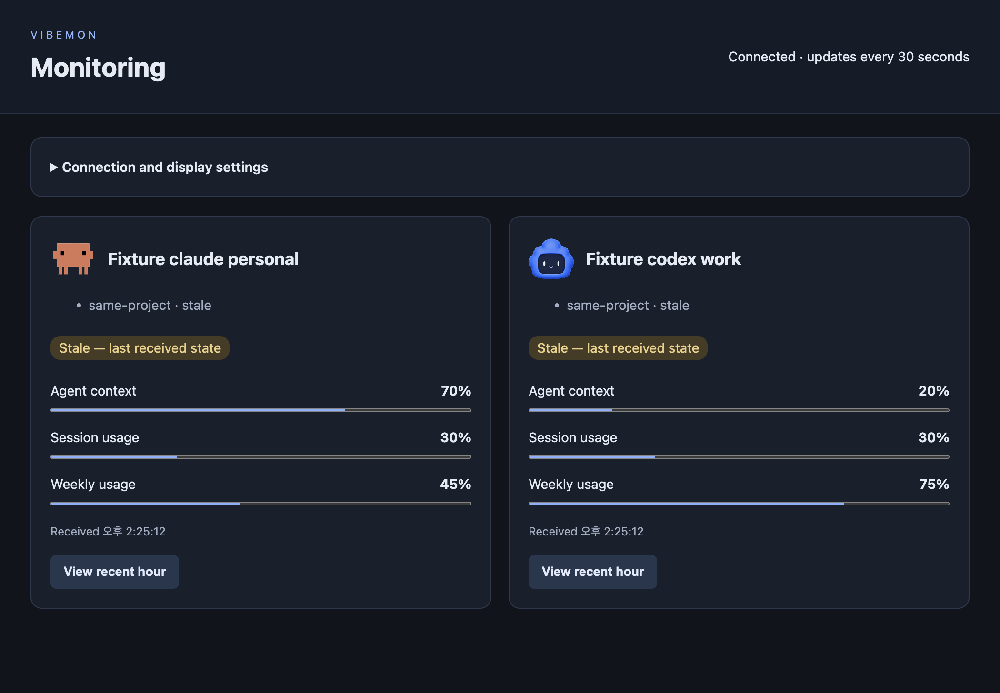

# Cloud monitoring

Open **Monitoring…** from the tray menu. Enter the Web origin and a generated read token, then select **Save and connect**. Create the token in [Account](https://vibemon.io/account) with Google login and use **Show token** to copy it. You can retrieve it again later. A write-only token cannot display data.

The read token is encrypted with Electron `safeStorage`, backed by the operating system keychain or secret service. No plaintext read token is returned to the renderer or written to preferences. Linux `basic_text` storage is rejected. Unlock or configure your OS secure storage if the app cannot save the token. To remove the local copy, select **Disconnect**. To invalidate it for every client, delete it in Web Account.

Select the resources, accounts, and metrics under **Connection and display settings**, then select **Apply display selection**. **Discover resources and accounts** refreshes the available list. Latest state is polled every 30 seconds, restricted to the selection. **View recent hour** loads minute aggregates and refreshes them every minute until the panel closes. No trend requests run while the panel is closed or the window is hidden.

Host cards display CPU, memory, GPU, and temperature. Spark uses **Unified memory**. Cluster cards display CPU, memory, ready/total nodes, and unhealthy pods. Agent cards preserve character and state information; fresh selected agent observations also enter the existing character-window routing path under cloud-specific IDs, keeping local hook projects separate.

Custom resource cards display the sender's resource type, short status message, metric labels, and units. Gauges use the declared minimum and maximum; number charts support signed values and automatic ranges. Define a database, queue, sensor, or any other type at the Web site's `/resources/new` page, then send real observations using the generated contract. No App code change is needed for a new type. After the first observation, discover and select the resource and its metrics. Custom metric choices are scoped to the source, so equal keys on different resources stay independent. A status-only resource has no numeric trend button.

Use **Edit metrics** on the Web dashboard to edit an existing resource, including Spark and Kubernetes presets. Saved labels, display ranges and metric order apply to Desktop on its next poll and survive new collector observations. Existing preset selections are preserved when edited definitions first appear. Values outside an edited gauge range remain measured values; new keys or units stay unavailable until matching collector definitions arrive.

- **Unavailable**: metric not supported, absent, or failed; it is never substituted with zero.
- **Stale**: no accepted server receipt for 120 seconds; values are the last known observation.
- **Token expired or revoked**: supply a current read token.
- **Permission denied**: use a token with `read` permission.
- **Cannot reach Web**: retained values remain visible and become stale as time passes.
- **No data yet**: connected account has no observations.

Chart gaps mean no recorded sample. Unchanged heartbeat messages refresh status but add no chart sample. A single observed minute appears as a point. The Web retains visible trends for 24 hours; this app requests only the recent hour.

The existing localhost hook endpoint and character/bubble behavior remain available without cloud configuration. HTTPS is required for cloud origins. An unpackaged development app also accepts loopback HTTP for isolated tests.

## Verification

`pnpm exec jest tests/monitoring.test.js --runInBand` verifies polling, selection, permissions, stale/offline recovery, late responses, and encrypted storage boundaries. `tests/native/monitoring-smoke.cjs` uses an isolated Web fixture to verify native Electron rendering and the actual OS encryption provider. Set `VIBEMON_TEST_FIXTURE` to the private fixture JSON emitted by Web's `scripts/local-monitoring-fixture.ts`; the native test never prints credentials.

## Multiple resources and accounts

Resources and provider accounts have separate selectors. Choose any combination of custom resources, Kubernetes clusters, Spark hosts, and coding accounts. Codex, Claude, Kiro and other agent types can each have several account IDs. Selection controls and cards group them by provider and show the account ID explicitly. A provider account card lists its project states and shows the latest observation's usage. Its recent-hour view aggregates that account's summaries; percentages are averaged, not summed.

The same project name can appear under several accounts. Selection and trend requests use provider/account keys and source IDs, never the project label. The Web site's `/coding-accounts/new` page generates launch settings, including `VIBEMON_KIRO_ACCOUNT_ID` / `_NAME` for Kiro. Use each tool's matching signed-in environment; identity metadata does not switch logins. Unsupported usage remains unavailable. See the [provider/account contract](https://vibemon.io/docs/api/monitoring#multiple-provider-accounts) for provider-specific overrides.

Remote status reception uses the HTTPS monitoring client. The former App WebSocket client and `VIBEMON_WS_URL` / `VIBEMON_WS_TOKEN` settings are removed. Configure the Web origin and a generated read token in Monitoring. Local HTTP hooks are unchanged. Read credentials are never reused for hook installation or copied into `~/.vibemon/config.json`.
