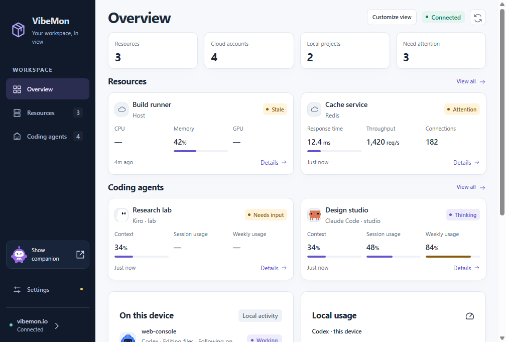

# Unified workspace verification

Verified on 2026-10-11. These results describe the `feat/unified-product-ux` branch, not an installed release.

## Review scope

[The inventory](unified-ux-inventory.json) records the digest and disposition of every tracked file, including retained files outside the changed UI. Source, configuration, tests, comments, guides, and authoring tools were read. Proposed Pet growth features remain proposals.

Character art, historical screenshots, the demo, and current workspace captures were inspected visually. Generated icons were checked against the shared mark; the ICO contains seven PNG sizes, and the packaged ICNS matches its source. The two vendored Three.js files match the locked installed package byte for byte and retain its MIT notice. Vendored minified code was reviewed at this provenance boundary, not manually deminified. Lockfiles were checked through manifests, overrides, integrity records, frozen installation, and the dependency audit. Public Web copies were compared with their reviewed App sources.

The inventory's own digest is recorded by Git instead of recursively embedding it. Ignored dependencies, caches, temporary test databases, and build outputs are outside the tracked-file inventory. No provider secrets or production observations are included in the review artifacts.

## Results

| Check | Result |
| --- | --- |
| Lint, shared design and registry/distribution checks | Passed |
| Jest and configured coverage gates | 750 tests in 38 suites passed; all four coverage gates met |
| Python hooks and collector | 305 tests and 64 subtests passed in an isolated environment |
| JavaScript integration plugins | 26 tests passed |
| Native workspace | Selection, focus, connection replacement, write-token verification, custom metrics, long labels, recovery, themes, and settings passed |
| Native companion | 83 scenarios passed, including fixed character → Auto and actual reduced-motion rendering |
| Windows | Workspace, overlays, 1.25×/1.5×/2× display scaling, and unpacked package passed |
| macOS | Workspace, overlays, and ARM64 unpacked package passed |

The [macOS/Windows workflow](https://github.com/opspresso/vibemon-app/actions/runs/38117126333) checks implementation commit `65a9c338d020147c4b0a9d5255ad2be71b563665`. Later evidence updates change only documentation and captures. Packaging verification does not establish signing, notarization, publication, or installed-app upgrades.

App and Web now use the same palette, brand, navigation, status labels, numeric presentation, and history conventions. Saved resource labels/order survive refresh. A rejected connection keeps the previous working credential and data. Local tool identity remains intact while the companion uses a fixed appearance. OpenClaw registry-refresh failures are reported as failures, without exposing arbitrary credential-bearing diagnostics.

## Screens

These captures use synthetic monitoring data. Web and App offer different platform actions but share the card hierarchy and visual foundation.

| macOS light | macOS dark |
| --- | --- |
|  |  |

## Release boundary

This change does not merge or publish a release. Deploy the companion Web changes before distributing Desktop's new **Save and verify** write-token action; it requires `GET /api/v1/connection?scope=write`. Existing hook ingestion uses `POST /api/status` independently. npm publication remains disabled.
