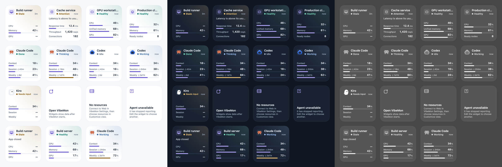

# macOS widgets

VibeMon adds two small widgets to macOS 14 or later. Each widget shows one item:

| Widget | Shows | Source |
| --- | --- | --- |
| **Resource** | State, collector message, and up to three metrics of one resource | Resources selected in **Customize view** |
| **Coding Agent** | State, context, session usage, and weekly usage of one provider account | Selected cloud accounts and local hook activity |

Add as many widgets as you need, for example one per server and one per coding account.



## Add a widget

1. Start VibeMon. The widgets read data that the App writes.
2. Control-click the desktop and select **Edit Widgets**, or open Notification Center and select **Edit Widgets**.
3. Search for **VibeMon Mac**. Drag **Resource · Mac** or **Coding Agent · Mac** to the desktop or Notification Center.
4. Control-click the new widget and select **Edit "Resource · Mac"** or **Edit "Coding Agent · Mac"**. Choose the item to show. Coding accounts are listed as provider plus short account ID, for example `Codex · 27e702a8`, with the account name and project names below. The list includes a resource icon or agent character. Search by name, account ID, or project to narrow the choices. Each choice keeps its original full ID.

If VibeMon is missing from the gallery, keep the App in `/Applications`, start it once, and reopen **Edit Widgets**. The widget extension is included with the macOS App; there is no separate widget installer.

If both apps are available, **VibeMon Mac** contains the widgets supplied by this Mac; **VibeMon iPhone** contains widgets supplied by your iPhone. Individual widget names also end in **Mac** or **iPhone**. Update the corresponding app to update its widgets.

A new widget leaves its selection empty and shows the first current item until you choose one. Click a widget to open its page in the Dashboard.

## What the widget shows

- **Header**: the icon, the name, and below the name the state in its color with the age of the last report, for example `3m`. The widget picker shows the account or resource type. States use the same names and rules as the Dashboard: a resource becomes **Stale** 120 seconds after its last receipt, and a coding agent ages to **Idle** and then **Inactive** when its hooks stop reporting.
- **Detail line**: the collector's message for a resource, or **App closed** after VibeMon quits. A coding agent has no detail line.
- **Metrics**: the first three metrics selected in **Customize view** for a resource. A coding agent shows **Context**, **Session**, and **Weekly**. A plan usage bar uses the warning color from 70% and the danger color from 90%. Beside **Session** and **Weekly**, `↻ 2h5m` is the time until that limit resets: `now`, minutes (`42m`), hours and minutes (`2h5m`), or days and hours (`3d1h`). It counts down without new data and is absent when the hook reports no reset time. `—` means no measurement was reported.
- **App closed**: VibeMon has quit. The values are the last known ones and keep aging.
- **Desktop not focused**: macOS draws the widget in one color. The character is then drawn without its tile, so its outline stays visible, and gauges are white on a faint track.

A coding agent combines all projects of one provider account. The state of the project that needs attention is shown first, for example a project waiting for input. Local hook reports replace the cloud copy of the same project. When a hook report has no usage, the widget uses the plan usage on this Mac.

## Notices

| Notice | Meaning and action |
| --- | --- |
| **Open VibeMon** | The App has not written widget data on this Mac. Start VibeMon. |
| **No resources** | No resource is selected. Connect to Web in **Settings → Connections**, then choose resources in **Customize view**. |
| **No coding agents** | No account has reported. Install an integration in **Settings → Integrations**, or select accounts in **Customize view**. |
| **Resource unavailable** / **Choose coding account** | The saved item is no longer available. Edit the widget to choose a current resource or account. |
| **Restart VibeMon** | The running App and the widget use different data versions, for example after an update. Quit and reopen VibeMon. |
| **Data unavailable** | The widget data cannot be read. Quit and reopen VibeMon. |

If an older coding widget stops showing measurements after automatic account detection is enabled, edit its account choice. A saved `codex:default` or `claude:default` is a different ID from the new automatically detected account. Choose the provider with its current short account ID. VibeMon preserves explicit selections and never silently points an old widget at another account. A `—` within an available account means that particular measurement was not reported.

## Refresh and privacy

Starting the packaged Mac App refreshes its own system registration before requesting new timelines. It stops the widget extension bundled at that App's path only when that process runs another file than the executable installed now, which is a worker that survived an App upgrade with a cached older bundle version. An upgrade writes a new executable file with a new inode, while the old worker keeps its old inode open; `lsof` reports that inode exactly. This setup runs after the local HTTP server starts and does not delay it. Saved widget choices and other apps' widget processes remain intact. If widgets stay blank after an update, quit and reopen VibeMon Mac.

- VibeMon writes `~/.vibemon/widgets/feed.json` about one second after a change. Only your user account can read the file.
- Each item includes its future states and reset times, so a widget changes to **Stale**, **Idle**, or **Inactive** and counts down to a reset on time without new data.
- macOS limits how often widgets refresh. VibeMon asks for a refresh at once when an item appears or disappears, its name or icon changes, or its state color changes, for example when a project starts to wait for input. Other changes, such as new metric values, refresh at most every 5 minutes.
- The widget extension runs in the App Sandbox. It can read only `~/.vibemon/widgets/`. It has no network access and never receives tokens.

## Develop

| Path | Contents |
| --- | --- |
| `src/widgets/feed.mjs` | The feed model. It applies the shared state, label, tone, and number rules. |
| `src/widgets/publisher.cjs` | Collects App data, writes the feed, and requests widget reloads. |
| `src/widgets/runtime.cjs` | Refreshes the installed App registration and stops only its exact widget executable before the first reload. |
| `native/macos/` | Xcode project: the widget extension (`Widgets/`, `Shared/`), the reload module (`WidgetCenter/`), and the preview tool (`Preview/`). |
| `scripts/build-macos-widgets.mjs` | Builds the Xcode products into `build/macos-widgets/Release/`. |
| `scripts/macos-widgets-packaging.cjs` | electron-builder hooks: builds the products before packaging and signs the extension. |

Requirements: Xcode 16 or later, selected with `xcode-select` or `DEVELOPER_DIR`.

```sh
pnpm preview:widgets   # Build, then render with the extension's bundled images (light, dark, approximate vibrant)
node scripts/verify-macos-widgets.mjs /Applications/VibeMon.app # Verify an installed or packaged App
pnpm test:design       # Feed model tests and the palette drift check
pnpm exec jest tests/widget-publisher.test.js tests/widget-runtime.test.js tests/deep-link.test.js
node tests/native/widget-runtime-smoke.cjs # Real process lifecycle, using disposable test workers
```

The package verifier checks the extension metadata, App/widget versions, URL scheme, reload module, three localizations, every registered character image, and the App icon. Its native tests check picker labels, search, images, saved choices, missing items, feed decoding, and timeline dates. It renders a second sheet using the packaged extension's images. These checks do not replace adding and editing a widget in the system gallery.

To check the installed App in the macOS gallery manually:

1. Search for **VibeMon Mac** and check its App icon, **Resource · Mac**, and **Coding Agent · Mac** previews.
2. Add each widget, edit it, and search for a specific resource or account. Check the icon, account ID, and project names.
3. Close the editor. Confirm the selected item remains after reopening it, and that clicking the widget opens the Dashboard.
4. Check focused and unfocused desktop appearance, then change the selected item's name or icon and confirm it refreshes. macOS controls the final refresh timing.
5. After an upgrade, confirm the installed widget process was replaced, `chronod` stores fresh timelines without `Bundle version did not match`, and the four displayed widgets show their selected data. The extension's “Request ended … success” only confirms generation; it does not prove that macOS accepted or displayed the archive.

Rules for changes:

- Keep state, label, and format rules in the App. The Swift code only lays out the feed.
- The feed carries labels in the App language. The widget's own text (notices, ages, countdowns, configuration) is in `native/macos/Widgets/Localizable.xcstrings`; `node scripts/generate-monitoring.mjs` fails when a widget string with the English of a `src/shared/i18n/shared.json` message has other translations.
- The App reads the OS language once at startup; the widget follows the OS language at once. After a language change, the widget shows its own text in the new language and the feed labels in the old one until the App restarts.
- A breaking feed change increases `WIDGET_FEED_VERSION` in `feed.mjs` and `WidgetFeed.supportedVersion` in `native/macos/Shared/Feed.swift`.
- `native/macos/Shared/Palette.swift` is generated from `src/shared/design/tokens.css`. After a token change, run `node scripts/generate-widget-palette.mjs --write`.
- WidgetKit accepts reload requests only from the main executable of the App that contains the widgets. For this reason the reload request comes from a Node-API module (`widget-center.node`) loaded by the Electron main process, not from a helper executable. An unpackaged `pnpm start` session writes the feed but does not request reloads.
- electron-builder does not sign `Contents/PlugIns`. The `sign` hook signs the extension with `native/macos/Config/Widgets.entitlements`, then signs the App.
